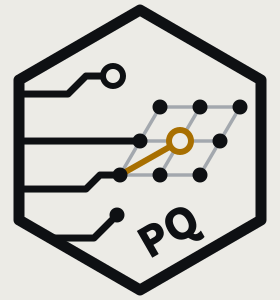

# <picture><source media="(prefers-color-scheme: dark)" srcset="images/pqhedge-icon.svg"></picture> What is covered

Every algorithm family in the repository, its standardization status, upstream pin and whether `make test-all` runs it.
Per-family detail: [`../algorithms/README.md`](../algorithms/README.md).

| Family | Category | Spec and status | Variants | Upstream (pinned) | In `test-all`? |
|---|---|---|---:|---|---|
| ML-KEM | [KEM](../algorithms/kem/README.md) | FIPS 203, **final** | 3 | [mlkem-native](https://github.com/pq-code-package/mlkem-native) `v2.0.0` (`d1b2fe78`) | yes |
| ML-DSA | [standard signatures](../algorithms/signatures/standard/README.md) | FIPS 204, **final** | 3 | [mldsa-native](https://github.com/pq-code-package/mldsa-native) `v2.0.0` (`834a90d5`) | yes |
| SLH-DSA | standard signatures | FIPS 205, **final** | 12 | [slhdsa-c](https://github.com/pq-code-package/slhdsa-c) `174c02e4` | yes |
| HQC | KEM | selected 2025, **standard pending** (no draft number confirmed) | 3 | [pqc-hqc/hqc](https://gitlab.com/pqc-hqc/hqc) `v5.0.0` (`f46e542`) | yes (labelled pending) |
| Falcon | standard signatures | round 3, **basis of FN-DSA (FIPS 206, not final)** | 2 | [falcon-round3](https://falcon-sign.info/falcon-round3.zip) (package SHA-256 `d625407d`) | yes (labelled pending) |
| Falcon fixed-point (experimental) | standard signatures | fixed-point prototype, not FN-DSA, not wire-compatible with round-3 Falcon | 2 | artifact of the fixed-point Falcon paper (URL / commit not recorded) | no |
| FN-DSA (experimental) | standard signatures | pre-standard best guess, **not FIPS 206** | 2 | [c-fn-dsa](https://github.com/pornin/c-fn-dsa) `1b858880` | no |
| FAEST, MAYO, MQOM, QR-UOV, SDitH, SNOVA, SQIsign, UOV | [on-ramp](../algorithms/signatures/onramp/README.md) | NIST additional signatures: **round-3 candidates** | 232 across all on-ramp rows (+ 12 FAEST-decoupled) | per family, see the on-ramp README | no |
| HAWK | on-ramp | round-3 candidate, **withdrawn by its team** (NIST page) | 3 | [hawk-sign/dev](https://github.com/hawk-sign/dev) (closest match `1b9fef52`) | no |
| CROSS, LESS | on-ramp, `round2-only/` | round 2 only (not among the nine round-3 candidates) | 18 + 7 | [CROSS](https://github.com/CROSS-signature/CROSS-implementation) (closest match `v2.0`), [LESS](https://github.com/less-sig/LESS) (closest match `v2.0.0`) | no |
| XMSS, LMS, HSS | [stateful](../algorithms/signatures/stateful/README.md) | NIST SP 800-208, final | 3 defaults (+134 via sweeps) | [xmss-reference](https://github.com/XMSS/xmss-reference), Cisco [hash-sigs](https://github.com/cisco/hash-sigs) (closest matches, not verified pins) | no |
| ASCON | [symmetric](../algorithms/symmetric/README.md) | Ascon **v1.2** code; SP 800-232 (final) defines different functions | 7 | [ascon-c](https://github.com/ascon/ascon-c) (closest match `v1.2.5`) | no |
| Kyber, Dilithium, SPHINCS+ round 3; SPHINCS+ Haraka | [legacy](../algorithms/legacy/README.md) | pre-standard, kept for comparison | — | tag `pre-fips-migration` | no |

`make test-all` covers exactly 23 variants: ML-KEM 3, ML-DSA 3, SLH-DSA 12, Falcon 2, HQC 3 (plus the two replays of the official Falcon round-3 KAT files).
Everything else has its own aggregate target (`test-onramp-ds`, `test-stateful-ds`, `test-ascon`, `test-fndsa-exp`, `test-falcon-fxp`; see [`makefile-flags.md`](makefile-flags.md)).
